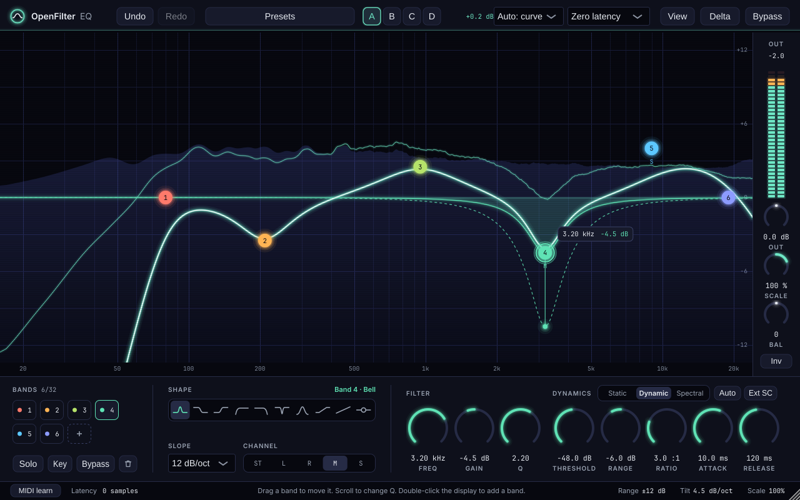
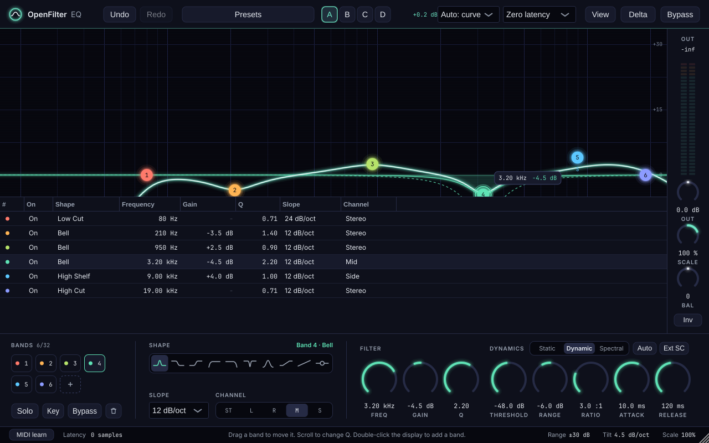
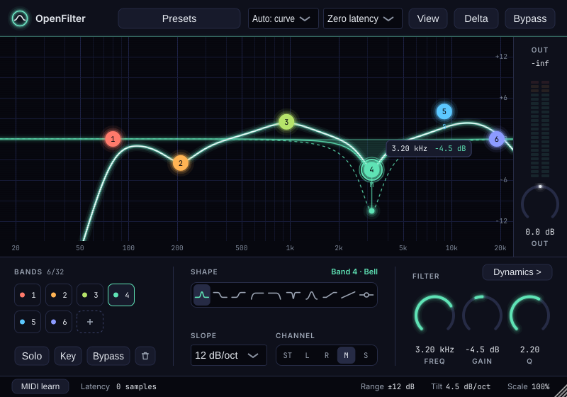

# OpenFilter EQ

An open-source equalizer plugin with up to 32 bands. Each band can be static,
dynamic or spectral, can sit on stereo, left, right, mid or side, and can be
minimum phase or linear phase.



VST3, CLAP, LV2 and standalone. Built with JUCE. Licence: AGPL-3.0-or-later.

**Status: 0.1.2, an early version.** It is developed and tested on Linux. The
Windows and macOS packages are built automatically and have not been tried in a
host yet, and nobody has tuned the plugin by ear. See [Known limits](#known-limits).

**Download 0.1.2:**
[Linux](https://github.com/asantamarian/openfilter/releases/latest/download/openfilter-eq-0.1.2-linux-x86_64-ubuntu22.tar.gz) ·
[Windows](https://github.com/asantamarian/openfilter/releases/latest/download/openfilter-eq-0.1.2-windows-x64.zip) ·
[macOS](https://github.com/asantamarian/openfilter/releases/latest/download/openfilter-eq-0.1.2-macos-universal.zip) ·
[all releases](https://github.com/asantamarian/openfilter/releases)

## Features

- **32 bands**, ten shapes: bell, low and high shelf, low and high cut, notch, band
  pass, tilt shelf, flat tilt, all pass. Slopes from 6 to 96 dB/oct, and brickwall
  cuts.
- **Placement per band:** stereo, left, right, mid or side.
- **Four phase modes:** zero latency, natural (follows the ideal curve to 20 kHz),
  linear (five lengths) and mixed, where each band chooses.
- **Dynamic bands:** threshold (manual, or automatic so the band reacts the same on
  quiet and loud material), range, ratio, knee, attack, release, lookahead, an
  external sidechain and a free detector filter.
- **Spectral bands:** the gain is decided separately for every frequency inside the
  band, so one ringing note can be turned down without its neighbours. A resonance
  mode treats whatever sticks out, at any level.
- **Analyzer:** input, output and sidechain, or a spectrogram; freeze, speed, tilt
  and range.
- **EQ match** to a sidechain, an audio file or another instance, and **curve
  sketching**: draw a curve and get bands.
- **Other instances** in the project drawn over your display, with strips marking
  where two tracks collide.
- **Auto gain** (estimated from the curve, or loudness matched), gain scale, delta
  listening, and a character stage with tube and iron saturation.
- **Workflow:** multi-band selection, a band table, typed values with note names
  (`A4`, `C#3`), A/B/C/D slots, undo history, JSON presets, MIDI learn.
- **Interface:** resizable from 800 x 560, scalable from 50 to 200 %, three themes
  and your own as JSON, keyboard operation and screen-reader labels on the controls.

How to use it all: [docs/manual.md](docs/manual.md).

| Band table | Smallest window |
|---|---|
|  |  |

## Install

Download the package for your system from the links above or the
[releases page](https://github.com/asantamarian/openfilter/releases), unpack it,
copy the plugin to your plugin folder, then rescan in your host.

| Format | Linux | Windows | macOS |
|---|---|---|---|
| VST3 | `~/.vst3/` | `C:\Program Files\Common Files\VST3\` | `~/Library/Audio/Plug-Ins/VST3/` |
| CLAP | `~/.clap/` | `C:\Program Files\Common Files\CLAP\` | `~/Library/Audio/Plug-Ins/CLAP/` |
| LV2 | `~/.lv2/` | | `~/Library/Audio/Plug-Ins/LV2/` |
| AU | | | `~/Library/Audio/Plug-Ins/Components/` |

All three packages are built by GitHub Actions. The Linux one is built on Ubuntu
22.04. The Windows and macOS ones compile and pass the DSP unit tests on those
systems, but nobody has loaded them in a host yet. The macOS build is universal
(Intel and Apple silicon) and is not signed or notarised, so macOS will block it
at first: after copying the plugins, run `xattr -dr com.apple.quarantine` on them,
or allow them under System Settings, Privacy & Security.

## Build from source

Requirements: CMake 3.22 or later, Ninja, a C++20 compiler.

Linux packages (Arch names): `alsa-lib freetype2 fontconfig libx11 libxrandr
libxinerama libxcursor libxext mesa`.

```
git clone --recurse-submodules https://github.com/asantamarian/openfilter.git
cd openfilter
cmake -S . -B build -G Ninja -DCMAKE_BUILD_TYPE=Release
cmake --build build
cd build && ctest
```

The plugins are written to `build/OpenFilterEQ_artefacts/Release/`, and on Linux the
build also copies them to `~/.vst3/`, `~/.clap/` and `~/.lv2/`. Pass
`-DOF_INSTALL_AFTER_BUILD=OFF` to turn that off.

| Option | Default | Meaning |
|---|---|---|
| `OF_BUILD_PLUGIN` | ON | Build the plugin (needs the JUCE submodule) |
| `OF_BUILD_CLAP` | ON | Build the CLAP format |
| `OF_BUILD_TESTS` | ON | Build the tests and tools |
| `OF_BUILD_AAX` | OFF | Build AAX (needs the Avid SDK at `AAX_SDK_PATH`) |
| `OF_INSTALL_AFTER_BUILD` | ON | Copy the plugins to the user plugin folders |

## Tests

`ctest` runs four things:

| Test | What it does |
|---|---|
| `of_tests` | 50 unit test cases for the DSP: filter design, kernel, engine, natural, linear, dynamics, spectral, character, curve fitting |
| `of_host_test` | Loads the built VST3 and LV2 the way a host does: transparency, gain, latency in every mode, parameter storms, state, sidechain, mono |
| `of_clap_test` | A minimal CLAP host doing the same for the CLAP |
| `of_snapshot` | Renders the editor to `build/editor*.png` and checks state, presets, slots, EQ match, the instance hub, MIDI learn, multi-selection and themes |

`./build/of_bench` measures CPU cost. The DSP core is also run under address,
undefined-behaviour and thread sanitizers; the commands are in
[docs/spec/07-build-test-release.md](docs/spec/07-build-test-release.md).

## CPU

The processing alone, 48 kHz, 512-sample blocks, stereo, as a share of one core of
a desktop processor:

| Situation | CPU |
|---|---|
| 8 static bells | 0.35 % |
| 24 mixed bands | 0.9 % |
| 24 bands, natural | 4.3 % |
| 24 bands, linear, medium | 1.0 % |
| 8 dynamic bands | 0.7 % |
| 4 spectral bands | 2.3 % |

## Known limits

- **Tested on Linux only.** The Windows and macOS builds have not been loaded in a
  host, and the macOS build is unsigned.
- **Not tuned by ear.** The dynamics defaults, the spectral processing and the
  saturation voicing pass their tests but have not been judged on real material.
- **Zero latency drifts in the top octave** at 44.1/48 kHz: about 1 dB around 9 kHz
  and 2 dB around 15 kHz against the drawn curve. Natural and linear modes do not.
- **Not validated with pluginval**, and only loaded by hand in Reaper.
- **Not tested:** a screen reader, hardware MIDI controllers, the LV2 editor in a
  real host.
- **Other instances** are visible only when the host runs them in the same process,
  and cannot be edited from another window.
- **In LV2 the sidechain is a required input**, so the plugin shows four inputs
  there (a workaround for a crash in JUCE's LV2 wrapper).
- No full-screen mode, no surround.

## Documentation

| File | Contents |
|---|---|
| [docs/manual.md](docs/manual.md) | User manual |
| [docs/spec/00-product.md](docs/spec/00-product.md) | Scope and feature list |
| [docs/spec/01-architecture.md](docs/spec/01-architecture.md) | Layout, threads, signal flow, latency |
| [docs/spec/02-parameters.md](docs/spec/02-parameters.md) | Every parameter |
| [docs/spec/03-dsp.md](docs/spec/03-dsp.md) | Filter design, phase modes, dynamics, spectral, with measured accuracy |
| [docs/spec/04-analysis.md](docs/spec/04-analysis.md) | Analyzer, instance hub, EQ match |
| [docs/spec/05-ui.md](docs/spec/05-ui.md) | Interface |
| [docs/spec/06-state.md](docs/spec/06-state.md) | State, presets, themes, MIDI |
| [docs/spec/07-build-test-release.md](docs/spec/07-build-test-release.md) | Build, tests, benchmarks |

The specs were written before the code and are kept in step with it: where the
build differs from the plan, the spec says what was built and what was measured.

## Licence and credits

OpenFilter EQ is free software under the GNU Affero General Public License,
version 3 or later (see [LICENSE](LICENSE)).

- [JUCE](https://juce.com), under its AGPLv3 option.
- [clap-juce-extensions](https://github.com/free-audio/clap-juce-extensions) and
  [CLAP](https://github.com/free-audio/clap), MIT.
- [Catch2](https://github.com/catchorg/Catch2), BSL-1.0, for the tests.
- Fonts: [Inter](https://rsms.me/inter/) and
  [JetBrains Mono](https://www.jetbrains.com/lp/mono/), SIL Open Font License;
  licence texts in `assets/fonts/`.

The feature set was planned against commercial equalizers as a benchmark. The
code, interface, presets and name are original.
